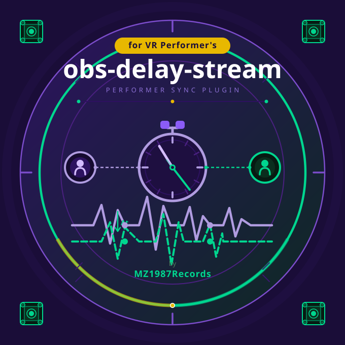

# obs-delay-stream  v9.0.0

**VRChat Dancer/Music Performer Support Tool [obs-delay-stream]**


[BOOTH](https://mz1987records.booth.pm/items/8134637) | [Report a Bug](https://github.com/MZ1987Records/obs-delay-stream/issues/new/choose) | [日本語](README.md)

<p align="center">
  
</p>

An OBS plugin that automatically measures and resolves sync drift between dancers and between dancer/world music — using only OBS and Google Chrome. It adds WebSocket audio streaming to OBS for performers.
Supports up to 20 simultaneous performer connections.

Each performer's individual delay is automatically measured, and a time-corrected audio stream is delivered to their Google Chrome browser for perfectly synchronized playback.
Also supports OBS broadcast (RTSP E2E) latency measurement for synchronization with audio streamed to the VRChat world.
A built-in cloudflared tunnel issues the receiver URL that performers use over the internet.

- No SYNCROOM or DAW required.
- Performers simply open the receiver URL (provided by the streamer) in Google Chrome to receive low-latency, synchronized audio.
- Does not affect the VRChat client.
- The receiver page supports volume control, re-sync / auto re-sync, spectrum meter, and JP/EN language display.

---

## Settings Tabs

| Tab | Description |
|------|------|
| Performer Names | Manage each performer's name. Add, remove, and reorder channels. |
| Tunnel | Generate a public URL via cloudflared. Performers connect through this URL, so starting it is required. |
| WS Streaming | Configure audio codec (Opus / PCM), start/stop the WebSocket server, and control transmission. |
| URL Sharing | View and copy all performer URLs at once. Reduces the hassle and risk of distribution errors. |
| WS Measurement | Auto-measure WebSocket delivery latency for all connected performers. Also supports auto-measurement on performer connect. |
| RTSP Measurement | Measure OBS broadcast (RTSP E2E) latency. Choose between Silent and Mix measurement modes. |
| Fine Tune | Per-channel environment latency settings and overall delay diagram. Also configure estimated avatar latency, and the local live-performance sync adjustment (lead time), here. |

---

## Installation

1. Download and extract the latest `obs-delay-stream-vX.X.X.zip` from [Releases](https://github.com/MZ1987Records/obs-delay-stream/releases) or [BOOTH](https://mz1987records.booth.pm/items/8134637).
2. The ZIP contains two options: `For ProgramData` and `For Program Files (legacy)`. Choose the one that matches your OBS installation.

### ProgramData Installation (Recommended)

1. Place `For ProgramData/plugins/obs-delay-stream` into:

```
C:\ProgramData\obs-studio\plugins\
```

2. Restart OBS Studio.

### Program Files Installation (Legacy)

1. Place `For Program Files (legacy)/obs-plugins/64bit/obs-delay-stream.dll` into:

```
C:\Program Files\obs-studio\obs-plugins\64bit\
```

2. Place `For Program Files (legacy)/data/obs-plugins/obs-delay-stream` into:

```
C:\Program Files\obs-studio\data\obs-plugins\
```

3. If existing files are present, overwriting them is fine (for updates).
4. Restart OBS Studio (administrator privileges may be required).

### Verify Installation

1. Launch OBS Studio.
2. Right-click an audio source (microphone, desktop audio, etc.).
3. Go to **Filters** → **+** → select **"obs-delay-stream"**.
4. If the GUI panel opens, installation was successful.

---

## Usage

### Initial Setup

1. Open the filter panel.
2. Enter each performer's name under the **Performer Names** tab.
3. Go to the **WS Streaming** tab and click **Start WebSocket Server**.

### Starting the Tunnel (Required for Sharing with Performers)

The WebSocket server listens only on this PC (127.0.0.1). Performers can connect only through the URL issued by the tunnel; direct connections by LAN IP address are not available.

1. Leave `cloudflared.exe path` as `auto` (only enter the exe path if you want to specify a custom location).
2. Click the **Start Tunnel** button (the exe will be downloaded automatically on first use by default).
3. A URL in the format `https://xxxx.trycloudflare.com` will be generated.

> **Note:** Security software may block `*.trycloudflare.com` and cause tunnel connection failures.
> If this happens, add `*.trycloudflare.com` as an exception (allowed).

In Auto mode, the plugin downloads the cloudflared version it has approved and verifies the file has not been modified before each launch. It is saved in a per-version folder:
`%LOCALAPPDATA%\obs-delay-stream\bin\cloudflared\<version>\cloudflared.exe`

`%LOCALAPPDATA%\obs-delay-stream\bin\cloudflared.exe`, downloaded by earlier versions, is no longer used and can be deleted. Executables from PATH or a manual path are not verified.

### Sharing Connection Info with Performers

In the **URL Sharing** tab, click **Copy performer URL list** and paste into Discord or similar. Have each performer open their corresponding URL in Google Chrome.

### Stopping and Resuming Public Access

To stop sharing with performers, stop in this order:

1. On the **Tunnel** tab, click **Stop**. The issued URL stops working and nobody can connect from the internet.
2. On the **WS Streaming** tab, click **Stop** for the WebSocket server. All connected performers are disconnected.

Quitting OBS also stops both. If OBS crashes, the cloudflared process started by the plugin is normally terminated as well. However, if the OBS log shows the warning `cloudflared is not in the kill-on-close job`, cloudflared may keep running. If it is left running and OBS is restarted, the previous URL becomes reachable again, so end `cloudflared.exe` in Task Manager.

To resume, start the tunnel again. Each time the tunnel starts, the URL domain changes, so share the URL list with performers again from the **URL Sharing** tab.

If a URL leaks to someone outside the performers, restarting the tunnel also makes the previous URLs stop working.

### Latency Measurement (Recommended Procedure)

1. Confirm that all performers are connected to the receiver page.
2. In the **WS Measurement** tab, measure all connected channels (auto-measurement on connect is also available).
3. After measurement completes, base delays are automatically applied to each channel.
4. In the **RTSP Measurement** tab, measure OBS broadcast latency (start OBS streaming beforehand).
5. If needed, use the **Fine Tune** tab to adjust environment latency and avatar latency.

### When a Vulnerability Is Found in cloudflared or FFmpeg

The cloudflared and FFmpeg used in **Auto** mode are pinned to versions the plugin has approved. The approved versions are shown in the notes under **cloudflared path** on the **Tunnel** tab and **ffmpeg path** on the **RTSP Measurement** tab. If a vulnerability is found in an approved version and a fixed plugin release is not out yet, you can switch to an exe you updated yourself as follows.

1. Stop the affected exe.
   - cloudflared: Stop the tunnel as described in [Stopping and Resuming Public Access](#stopping-and-resuming-public-access).
   - FFmpeg: Do not run measurements on the **RTSP Measurement** tab (FFmpeg runs only while measuring).
2. Install the latest version from the official source.
   - cloudflared: Download `cloudflared-windows-amd64.exe` from Cloudflare's official GitHub releases (<https://github.com/cloudflare/cloudflared/releases>), or install it with `winget install --id Cloudflare.cloudflared`.
   - FFmpeg: Download a win64 ZIP from one of the Windows builds (gyan.dev or BtbN) linked from the official FFmpeg download page (<https://ffmpeg.org/download.html>), extract it, and use `bin\ffmpeg.exe`.
3. Switch the plugin's exe path setting.
   - In the **cloudflared path** or **ffmpeg path** dropdown, choose one of the following.
   - **Resolve via %PATH%**: Uses `cloudflared.exe` / `ffmpeg.exe` in a folder on PATH. The file name must be exactly this. If you changed PATH or installed with winget, restart OBS before choosing this. To check which exe will be used, run `where cloudflared` / `where ffmpeg` in Command Prompt.
   - **Absolute path**: Enter the full path to the exe in the input field (for example, `C:\tools\cloudflared\cloudflared-windows-amd64.exe`).
4. Start again with the new exe.
   - cloudflared: **Start** the tunnel. The URL domain changes, so share the URL list with performers again from the **URL Sharing** tab.
   - FFmpeg: The new exe is used from the next measurement.

> **Note:** The plugin does not verify the exe used with **Resolve via %PATH%** or **Absolute path**, as the note says. Confirm yourself that it came from the official source above, and check it against a hash if the distributor publishes one.

Once a fixed plugin release is out, update the plugin and set **cloudflared path** and **ffmpeg path** back to **Auto**. Back in Auto mode, the new approved version is downloaded and verified before each launch.

---

## Developer Information

For build instructions, troubleshooting, and file structure, see [BUILDING.md](BUILDING.md).

---

## License

- [GNU General Public License v2.0 or later](LICENSE)
- For third-party licenses, see [THIRD_PARTY_NOTICES](THIRD_PARTY_NOTICES).
